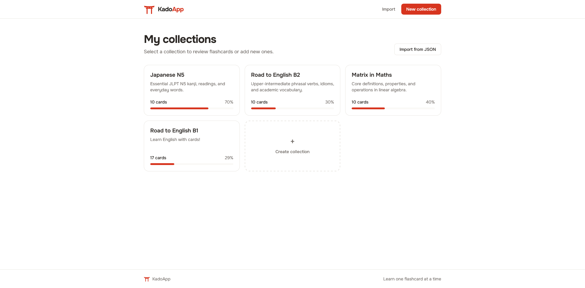
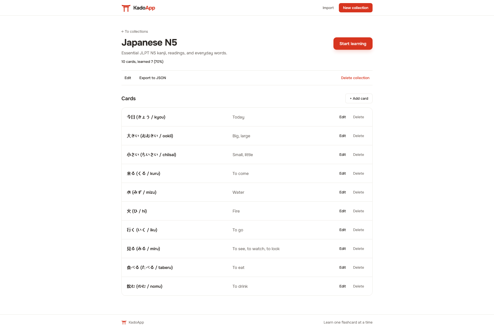
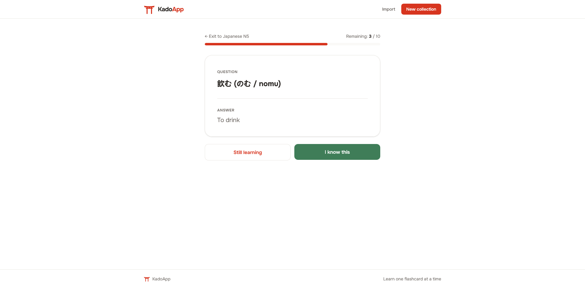

# KadoApp

A local web application for learning vocabulary, grammar, and concepts using flashcards. Built with Laravel, Tailwind CSS, and SQLite.

## Features
- **Collections & Cards Management:** Create, edit, and delete flashcard collections and individual cards with pagination.
- **Interactive Learning Mode:** Review cards one by one, reveal answers, mark progress (*Still learning* / *I know this*), and reset progress anytime.
- **Progress Tracking:** Real-time completion percentages and progress bars on both collection cards and detail pages.
- **JSON Export & Import:** Back up your collections or share decks via clean, human-readable `.json` files.
- **Zero-Config Local Storage:** Powered by SQLite with automatic database initialization and migrations.

## Tech Stack
- **Backend:** PHP 8.5+, Laravel 12
- **Frontend:** Blade Templates, Tailwind CSS, Vite
- **Database:** SQLite
- **Containerization:** Docker & Docker Compose

## Screenshots

| My Collections | Collection Details | Learning Mode |
| :---: | :---: | :---: |
|  |  |  |

## Running with Docker (Recommended)

1. Build and start the container:
   ```bash
   docker compose up --build
   ```
2. Open in your browser: [http://localhost:8000](http://localhost:8000)

The SQLite database is mounted from `./database/database.sqlite`, so your collections and study progress persist across container restarts.

To stop the application, press `Ctrl + C` or run:
```bash
docker compose down
```

## Local Setup (Without Docker)

**Requirements:** PHP 8.5+, Composer, Node.js 18+.

1. Install PHP and frontend dependencies:
   ```bash
   composer install
   npm install
   ```
2. Set up the environment and database:
   ```bash
   cp .env.example .env
   php artisan key:generate
   touch database/database.sqlite
   php artisan migrate
   ```
3. Start the development server:
   ```bash
   composer run dev
   ```
4. Open in your browser: [http://127.0.0.1:8000](http://127.0.0.1:8000)

## JSON Import Format

You can import decks using a UTF-8 `.json` file matching the following schema:

```json
{
  "name": "Japanese N5",
  "description": "Basic vocabulary",
  "cards": [
    { "question": "水 (みず)", "answer": "Water" },
    { "question": "火 (ひ)", "answer": "Fire" }
  ]
}
```
